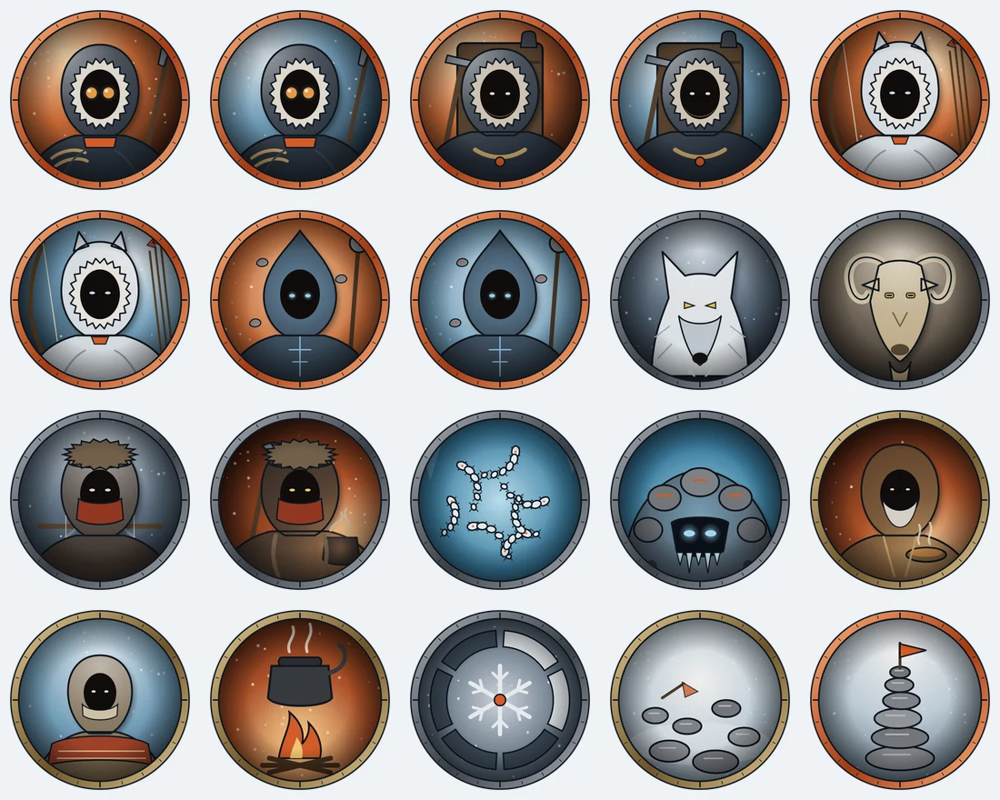

# Cairnkeepers

*A game of rope, weather and the safe way through, made for this VTT.*

The Whitecrown pass is marked by **cairns**, one in sight of the next, and the guild of
**Cairnkeepers** keeps them standing. This winter came early, the cairns are being moved, and a
salt caravan is missing above the treeline. The players are **Guides** who go up when nobody else
will. Mountain-rescue survival with a strange edge, for a GM and 2–5 players.

It's a light **2d6** game built around two things the board now enforces itself:

- **The ground.** Every square is Normal, **Difficult** (deep snow, scree, thin ice: the ruler
  counts it double) or **Blocked** (crevasses, open water: no move goes in). The maps come with
  their ground painted, and the mountain changes it during play: avalanches, rockfalls and
  cracking ice are **temporary terrain effects** the GM paints.
- **What you can see.** The **weather sets the sight range** (Clear, Haze 60 ft, Snowfall 30 ft,
  Squall 15 ft, Whiteout 10 ft). Rock and walls block **line of sight**; **ice is a window** you see
  through but can't pass; **pines and steam are fog** that nobody can see into. Wolves lie still in
  the snow as hidden tokens until someone spots them.



## What's here

| | |
|---|---|
| [`rules.md`](rules.md) · [`cairnkeepers-rules.pdf`](cairnkeepers-rules.pdf) | The rules: dice, the ground, sight and weather, combat, Warmth and the Storm Clock, the four callings. The PDF is a field-book printout of the rules and the bestiary. |
| [`bestiary.md`](bestiary.md) | Six foes, the hospice's keeper, a survivor and the board pieces, each with a **platform entry** to type into a library creature. |
| [`adventure.md`](adventure.md) · [`the-winter-road.pdf`](the-winter-road.pdf) | *The Winter Road*: one session, four maps, levels 1 to 2. For the GM. |
| [`character-sheet/`](character-sheet/) | `sheet.html`, which you can fill in the browser and print. `cairnkeepers-character-sheet.pdf` is the blank sheet plus a quick reference; `pregens/` holds four ready Guides. |
| [`art/maps/`](art/maps/) | 4 maps: 2 outdoor (the Switchbacks, Greywater Tarn) and 2 indoor (the Hospice of St. Brenn, the Ice Caves). Each comes as a `.webp`, a `.dd2vtt`, a GM key showing the ground, and `.board.json`: its walls, doors, windows, ice, terrain and fog. |
| [`art/tokens/`](art/tokens/) | 20 tokens: 4 callings × 2, 6 foes, Brother Aldric, a survivor, Warmth, the Storm Clock, and a cairn fallen and raised. |
| [`art/CREDITS.md`](art/CREDITS.md) | How the art is made. |
| [`VERIFICATION.md`](VERIFICATION.md) | What was checked, and how. |

## Running a session

**Once, as the GM:** run the setup script against your account. It does everything, ready to play:

```bash
CAIRNKEEPERS_EMAIL=… CAIRNKEEPERS_PASSWORD=… npx tsx scripts/cairnkeepers/setup-library.mjs --server=http://localhost:3001
```

- the four **maps** in your library, each with its walls, doors (the chapel door locked), windows,
  **ice** (locked windows: see-through, impassable), **terrain** and **fog**;
- the **token art** and a **library creature** for every foe, board piece and pregen;
- an **encounter template** for each scene;
- a room, **Cairnkeepers · The Winter Road**, with all four scenes prepared: the first live, each
  with line of sight on, the sight range for its weather, and its tokens sorted into **token
  groups** (Guides, each kind of foe, Board pieces).

By hand, the adventure's *Before you play* lists the same steps (UVTT can't say which openings are
ice, or carry terrain and fog, so it takes longer: the GM keys show the ground to paint).

**Each session:** open the room, hand each player their Guide's token (**Owners**), and switch
scenes from the room header as the Guides move on. Set the sight range when the weather turns, and
paint the mountain's changes as temporary terrain.

**Players** need rules §1–7 and their calling in §9, or just the quick reference on the back of the
sheet.

## Rebuilding the files

Everything is generated from source, so change a layout, a stat or a sentence and re-run:

```bash
node scripts/cairnkeepers/render-maps.mjs      # maps, .dd2vtt, board.json, GM keys (art/maps/)
node scripts/cairnkeepers/render-tokens.mjs    # tokens and the token sheet (art/tokens/)
node scripts/cairnkeepers/render-sheets.mjs    # character sheet, pregens, rulebook and adventure PDFs
```

The maps come from `scripts/cairnkeepers/layouts.mjs`, one character per square: the same grid
draws the art and builds the walls, the ice windows, the terrain and the fog. The pregens come
from `character-sheet/pregens.json`, and the PDFs from the Markdown files here.
