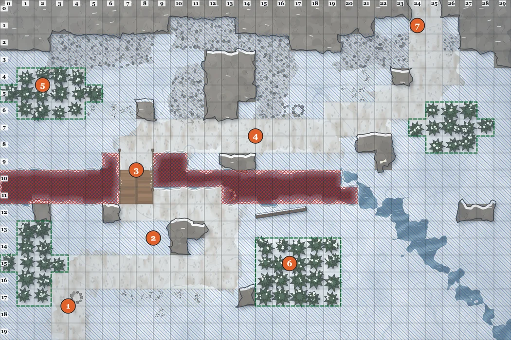
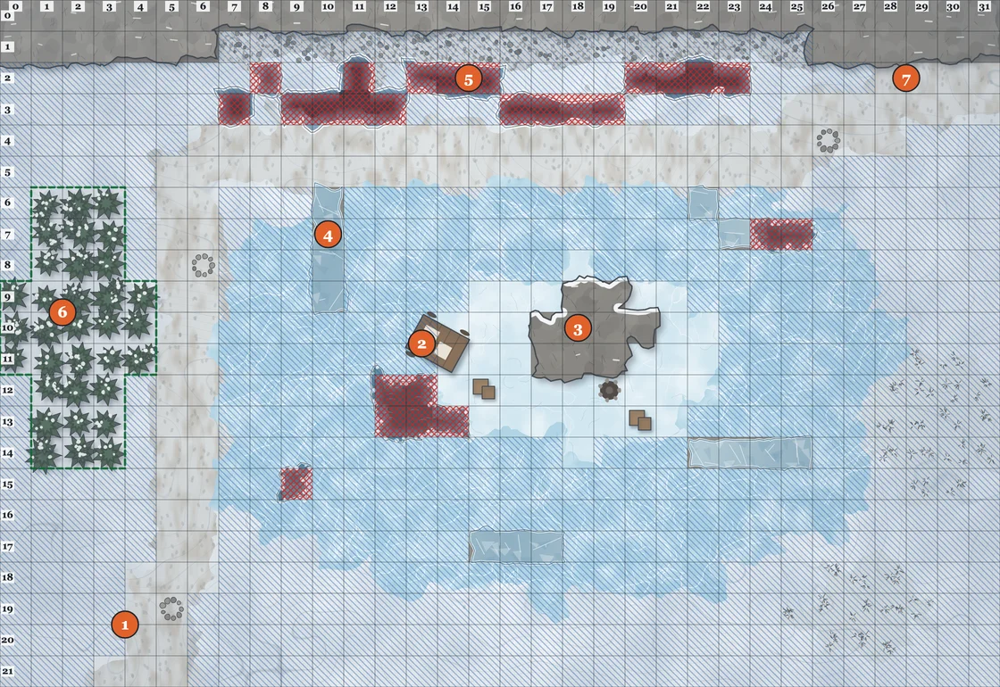
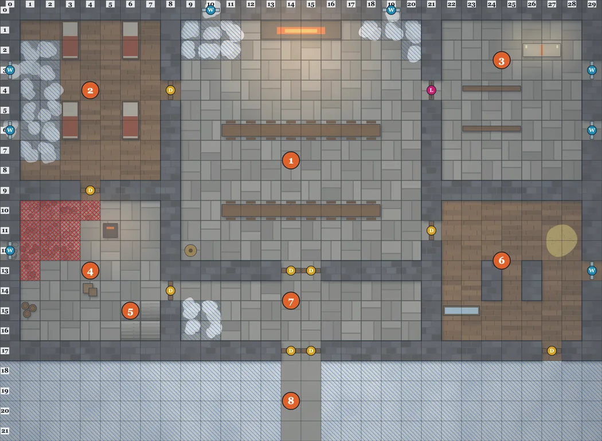
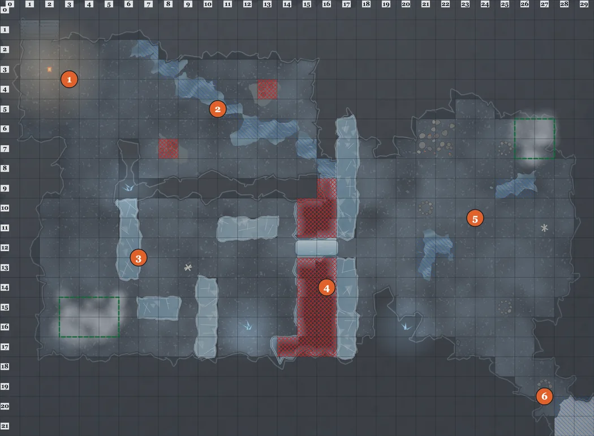

# The Winter Road

*A Cairnkeepers adventure for 3–5 Guides of level 1. One session of three to four hours. The Guides
reach level 2 at the hospice.*

**For the GM only.** Squares are written as **(column, row)**, counted from 0 at the top-left, as
printed along the edges of each map's GM key, shown with its scene. Numbers in **bold brackets**,
like **[3]**, are the numbered areas on the key. On the key, blue hatching is Difficult ground, red
crosses are Blocked, and green dashed outlines are obscuring ground (fog).

## The story so far

Six days ago the salt caravan of **Marrow & Daughters** — two wagons, nine mules, seven people —
left Brennford for the Whitecrown pass. It never reached the hospice on the far side. The snow
came three weeks early, and the guild gives the road four more days before it closes for the
winter.

What nobody in Brennford knows:

- The **Rimehands**, led by **Kettle Varga**, have been knocking down cairns to send travellers onto
  thin ice, where they loot what the lake keeps. They took the **Hospice of St. Brenn** two days
  ago and locked its last brother, **Aldric**, in his own chapel.
- Varga hasn't been doing it alone. Something under the hospice has been *moving* cairns, leading
  the safe way wrong, and Varga has been leaving it the stones. It's called the **Cairn-Taker**, and
  every cairn it carries off is a road nobody will find again.
- Three of the caravan's people are alive: two on the island in Greywater Tarn, where their wagon
  went through the ice, and one hiding in the hospice dormitory.

**What the Guides must do:** climb the Switchbacks, find the caravan, take back the hospice, and go
down under it to bring back the stones, before the pass closes.

## Before you play

1. **Create a room.** Its grid is already 5 ft a square. The token editor also offers Charmed and
   Paralyzed, which Cairnkeepers doesn't use.
2. **Get the four maps into your library, with their ground.** The easy way is the setup script
   (`setup-library.mjs`), which also makes everything below. By hand:
   - **Library → Maps**, choose each map's `.dd2vtt`. Its grid, rock walls and openings come in.
   - In the map's editor, **Walls**, **Door** tool: make each opening what *The openings* below
     says.
   - **Terrain**: paint Difficult and Blocked as the GM key shows.
   - **Fog**: lay a region over each obscuring stand the key outlines in green.
3. **Make the library creatures** from [the bestiary](bestiary.md) at the back of the rulebook,
   each with the token art its entry names.
4. **Hand out the pregens** (the four ready-made Guides' sheets), or make Guides with the blank sheet.
   Each player's token needs its HP, Max HP, AC (its Guard) and named attacks from the sheet's
   *On the table* card.
5. **Place the board pieces:** a **Warmth** token at **12/12** off to one side of every map (the
   pregens' party has a Hauler, Tor, so it starts at 12: rules §7, Packhorse), and a hidden **Storm
   Clock** (0/6) that only you see. Each scene's board setup puts them at (0, 0) and (1, 0).

| Scene | Map | Weather | Fight | Threat |
|---|---|---|---|---|
| 1 | The Switchbacks | Haze, 60 ft | 4 White-coats | 4 |
| 2 | Greywater Tarn | Snowfall, 30 ft | 4 Rimehands, cracking ice | 4 |
| 3 | The Hospice of St. Brenn | lamplight, 40 ft | Kettle Varga and 2 Rimehands | 6 |
| 4 | The Ice Caves | lantern, 30 ft | 2 Ice-crawler swarms, then the Cairn-Taker | 4, then 10 |

Roll the weather at the start of each outdoor scene (rules §5.1); the table above is what to use if
you'd rather not. Each scene is one watch: Warmth goes down and the Storm Clock goes up as the rules
say.

**The openings.** Every door and window on each map, by its square:

- **The Switchbacks:** none.
- **Greywater Tarn:** 18 openings, and every one is **ice**: a **window**, **locked**, so it can be
  seen through but never opened or passed.
- **The Hospice of St. Brenn:** 18 openings, all **closed** except the chapel door, which is
  **locked**.
  - **10 doors:** dormitory to great hall (8, 4); great hall to chapel (21, 4), **locked**;
    dormitory to kitchen (4, 9); great hall to stable (21, 11); kitchen to porch (8, 14); great hall
    to porch, the **porch doors** (14, 13) and (15, 13); porch to courtyard, the **front doors**
    (14, 17) and (15, 17); stable to courtyard, the **stable door** (27, 17).
  - **8 windows:** in the great hall (10, 0) and (19, 0); the dormitory (0, 3) and (0, 6); the
    chapel (29, 3) and (29, 6); the kitchen (0, 12); the stable (29, 13).
- **The Ice Caves:** 20 openings, and every one is **ice**: a **window**, **locked**.

**Board setup.** Each scene has a table of every token to place at the start: its name on the
board, its square, whether it starts **hidden**, and its **Art**, the token image's file name
without `.webp`. A token takes its values from its library creature. The four Guides are the
pregens; Pell Marrow, Oskar, Jory and Hesk are **Caravan Survivors**; a numbered token (Cairn 1,
White-coat 2) is its creature with a number. Every token is 1×1 except the Cairn-Taker, which is
3×3, placed by its top-left square.

---

## Scene 1 — The Switchbacks

> The road out of Brennford ends at a cairn with a guild ribbon, and above it the mountain begins:
> a trail of trodden snow zig-zagging up through scree and dwarf pine, a gorge you can hear before
> you see it, and the cliffs of the Whitecrown above, white on grey. The cairn beside the trail has
> been kicked flat.

**On the board.** Line of sight on, **sight range 60 ft** (Haze). The Guides start at the
**trailhead [1]**, (3–4, 18–19). Fog lies over the four pine stands **[5]**, **[6]** and the two
smaller ones.

- **Three fallen cairns** on the way up: **Cairn (fallen)** tokens at (4, 17), (13, 11) and (17, 6).
  Raising one is an Action and Lore 8 (rules §5.4).
- **4 White-coats**, **hidden** and **Invisible**, lying still in the snow at the edge of the **wolf
  pines [6]**: (14, 14), (14, 16), (16, 13) and (19, 13).

**Board setup.**

| Token | Square (column, row) | Hidden | Art |
|---|---|---|---|
| Sela Varn | (3, 18) | no | `pathfinder-a` |
| Tor Breck | (4, 18) | no | `hauler-a` |
| Wren Ashby | (3, 19) | no | `hunter-b` |
| Mira Hale | (4, 19) | no | `stonespeaker-b` |
| Cairn 1 | (4, 17) | no | `cairn-fallen` |
| Cairn 2 | (13, 11) | no | `cairn-fallen` |
| Cairn 3 | (17, 6) | no | `cairn-fallen` |
| White-coat 1 | (14, 14) | **yes** | `white-coat` |
| White-coat 2 | (14, 16) | **yes** | `white-coat` |
| White-coat 3 | (16, 13) | **yes** | `white-coat` |
| White-coat 4 | (19, 13) | **yes** | `white-coat` |
| Scree Goat | (21, 3) | **yes** | `scree-goat` |
| Warmth | (0, 0) | no | `warmth` |
| Storm Clock | (1, 0) | **yes** | `storm-clock` |

### The ground

The trail is **Normal** ground; everything off it is **deep snow** (Difficult) or **scree**
(Difficult) under the cliffs. The **gorge** (Blocked) cuts the map in two along rows 10–11; the
**rope bridge [3]** at (7–8, 10–11) is the only quick way across. The long way round is east, where
the gorge narrows into a **stream** (Difficult) at (20–21, 10–11): six squares of deep snow and
water instead of two of planks.

Say all of this as the Guides arrive. Let them see the ruler count it.

### The wolves

The pack waits until the first Guide reaches the **lower switchback [2]** at around (12, 13), then
rises: reveal the four, remove **Invisible**, and roll initiative (they use 8). A Guide who looks
first (Spyglass, or a Sense 8 check as they come level with the pines) spots them and the Guides get
the first round.

- They run when two are down. Downhill, through the pines, where nobody can follow by sight.
- **Fill one Storm Clock segment** if anyone shouts or fires across the slope.

### The rockfall

As the Guides cross the **ledge [4]** after the bridge, the slope above lets go. Give them a sound
first: a crack, then a hiss of snow. On the next round, paint a temporary effect named **Rockfall**,
**Blocked**, on (15, 7), (16, 7), (15, 8) and (16, 8). Anyone standing there saves **Footing 9**: on
a failure, **1d8+2** and **Prone** in the nearest open square.

The ledge is closed. The way on is down through **deep snow** along row 9, between the boulders and
the gorge's edge, and back up to the trail at (17, 7). Take your time describing the gorge.

### Up and out

The way north is the **gap [7]** at (24–25, 0). A **Scree Goat** stands on the scree at (21, 3)
if you want one more beat: it doesn't care about the Guides until they come within 2 squares, and
then it butts the nearest one toward the edge of the gap.

---

## Scene 2 — Greywater Tarn

> Over the gap the land opens into a bowl of white, and in the middle of it lies the tarn: a lake
> frozen grey-green, ridged with walls of upended ice. Out on it, near a rock island, a wagon lies
> on its side at the edge of black water. People are moving round it. Not the caravan's people.

**On the board.** Line of sight on, **sight range 30 ft** (Snowfall). The Guides arrive on the
**south shore [1]**, (3–5, 20–21). Fog over the **shore pines [6]**.

- **4 Rimehands**, **visible**, but out of sight at first in the snow:
  - two looting **the wagon [2]**, at (12, 10) and (15, 11);
  - two with crossbows **behind the pressure ridge [4]**, at (11, 7) and (11, 8).
- **3 Caravan Survivors** by **the island [3]**, at (16, 10), (21, 10) and (19, 12): Pell Marrow
  (the daughter), Oskar the muleteer, and Jory, eleven.
- **Three fallen cairns** along the shore trail, at (5, 19), (6, 8) and (26, 4). In Snowfall, a raised
  cairn makes it Haze within 6 squares (rules §5.4).

**Board setup.**

| Token | Square (column, row) | Hidden | Art |
|---|---|---|---|
| Sela Varn | (3, 20) | no | `pathfinder-a` |
| Tor Breck | (4, 20) | no | `hauler-a` |
| Wren Ashby | (3, 21) | no | `hunter-b` |
| Mira Hale | (4, 21) | no | `stonespeaker-b` |
| Rimehand 1 | (12, 10) | no | `rimehand` |
| Rimehand 2 | (15, 11) | no | `rimehand` |
| Rimehand 3 | (11, 7) | no | `rimehand` |
| Rimehand 4 | (11, 8) | no | `rimehand` |
| Pell Marrow | (16, 10) | no | `survivor` |
| Oskar | (21, 10) | no | `survivor` |
| Jory | (19, 12) | no | `survivor` |
| Cairn 1 | (5, 19) | no | `cairn-fallen` |
| Cairn 2 | (6, 8) | no | `cairn-fallen` |
| Cairn 3 | (26, 4) | no | `cairn-fallen` |
| Warmth | (0, 0) | no | `warmth` |
| Storm Clock | (1, 0) | **yes** | `storm-clock` |

### The ground

The tarn is **thin ice** (Difficult) all the way out, except a ring of **thick ice** round the
island (Normal). The **pressure ridges [4]** are walls of clear ice: everyone sees through them,
nobody passes them. **Open water** (Blocked) where the wagon went through, (12–14, 12–13), and at
(9, 15) and (24–25, 7). The north shore is **crevassed** [5] under the cliffs, right beside the
trail.

The Rimehands roll Footing for bad ground with an Edge: they know this ice.

### The cracking ice

The ice around the hole can't take a fight. When two or more creatures stand within 2 squares of
the hole, or anything is fired at the wagon, it starts to go. Tell the Guides first: a long
groan, and white lines running out from the black water.

Paint a temporary effect named **Cracking ice**, **Blocked**, and add to it at the start of each
round:

| Round | Squares that break |
|---|---|
| 1 | (11, 12), (11, 13), (12, 14), (13, 14), (14, 14) |
| 2 | (10, 12), (10, 13), (11, 14), (12, 11), (13, 11), (15, 14) |
| 3 | (9, 12), (9, 13), (10, 14), (11, 11), (12, 15), (13, 15), (14, 15) |

The thick ice round the island doesn't break. Anyone in a square as it breaks saves **Footing 8**
or falls in: **Restrained**, **1d6** cold at the start of each of their turns, until hauled out
(rules §4.1).

### The Rimehands

- They want the salt, not a fight. They shoot from behind the ridge and run when two are down,
  north along the shore trail, past the crevasses.
- Anyone who catches one learns: *"Varga's at the hospice. She's got the monk. She said the stones
  were all going under."*
- **Fill one Storm Clock segment** for the crossbows, and one if anyone goes through the ice.

### The survivors

Pell, Oskar and Jory have been on the island two days, under the wagon's tarpaulin. Getting them
off the ice is the fight's real goal. They follow the Guide who leads them (rules: Caravan
Survivor) and move at 4. Pell knows one more of them, **Hesk**, ran for the hospice the night the
wagon went through.

The way on is the **hospice road [7]** at the north-east, (30–31, 2–3).

---

## Scene 3 — The Hospice of St. Brenn

> The hospice is a long stone house with a bell-gable and every shutter nailed shut against the
> wind, except the ones that aren't, which bang. There's smoke from the hall chimney and a line of
> mules in the stable yard. Someone has drawn a cairn on the front door in soot, and crossed it out.

**On the board.** Line of sight on, **sight range 40 ft** (lamplight indoors). The Guides arrive in
the **courtyard [8]**, (14–15, 18–21). Doors are closed; the **chapel door [3]** at (21, 4) is
**locked**.

- **Kettle Varga** in the **great hall [1]** at (14, 5), by the long table, with the hearth behind
  her.
- **2 Rimehands** with crossbows in the hall at (10, 7) and (19, 7).
- **Brother Aldric**, locked in the **chapel [3]**, at (26, 3).
- **Hesk**, a Caravan Survivor, **hidden** under a bunk in the **dormitory [2]** at (6, 6).

**Board setup.**

| Token | Square (column, row) | Hidden | Art |
|---|---|---|---|
| Sela Varn | (14, 19) | no | `pathfinder-a` |
| Tor Breck | (15, 19) | no | `hauler-a` |
| Wren Ashby | (14, 20) | no | `hunter-b` |
| Mira Hale | (15, 20) | no | `stonespeaker-b` |
| Kettle Varga | (14, 5) | no | `kettle-varga` |
| Rimehand 1 | (10, 7) | no | `rimehand` |
| Rimehand 2 | (19, 7) | no | `rimehand` |
| Brother Aldric | (26, 3) | no | `brother-aldric` |
| Hesk | (6, 6) | **yes** | `survivor` |
| Warmth | (0, 0) | no | `warmth` |
| Storm Clock | (1, 0) | **yes** | `storm-clock` |

### Talking

Varga would rather talk. If the Guides knock, she opens the porch door herself and offers terms:
the Rimehands walk away with their mules and half the salt; the Guides get the hospice and the
monk. She's frightened, and if pressed (Sense 10, or Lore 8 with what the tarn's Rimehands said),
she admits why: *"It wants all of them. Every cairn on the pass. I gave it what it asked, and it
asked for more."*

If they take the deal, she gives them the chapel key and tells them about the cellar.

### Fighting

If it comes to a fight, the Rimehands shoot from behind the pillars **[1]** (rock blocks sight; the
long tables are partial cover) and Varga holds the **porch doors** at (14–15, 13). She uses her
Smoke Kettle when two Guides come through together. She surrenders at 6 HP.

### The snowdrift

Midway through the fight, the wind changes. Paint a temporary effect named **Snowdrift**,
**Blocked**, on the **front doors** at (14, 17) and (15, 17): the Guides can't leave that way.
The **stable door** at (27, 17) and the **windows** are the other ways out. A window takes an
Action to open and costs 2 squares to climb through.

Indoors, the drifts that came in through the broken shutters are already **Difficult**: the
dormitory's west side, the hall's north corners and the porch's west end. The kitchen's collapsed
corner is **rubble** (Blocked).

### Brother Aldric

The chapel key is on Varga. Aldric is seventy and entirely unafraid. Once he's out:

- The hearth is lit, so a night here refills Warmth: **a long rest**, and the Guides reach **level
  2** (rules §8).
- He knows what lives under the hospice. *"The old brothers built over it on purpose. You keep a
  thing like that where you can hear it."* The **cellar stairs [5]** at (6–7, 15–16) go down to the
  ice caves. He'll come, and with him the Guides have an Edge on Footing for bad ground below.
- He gives them three bowls of his broth (bestiary: Brother Aldric).

---

## Scene 4 — The Ice Caves

> The cellar stairs go down further than a cellar should, and come out into ice. Not a cave with ice
> in it: ice with a cave in it, blue and clear and full of old air. A stream runs across the floor.
> Somewhere deeper, stone grinds on stone, slowly, like something rearranging furniture.

**On the board.** Line of sight on, **sight range 30 ft** (storm lanterns). The Guides come down
the stairs of the **cellar way [1]**, at (1–2, 1), and stand at their foot, (1–2, 2–3), with
**Brother Aldric** beside them at (3, 2). Fog over the steam vents in the **ice maze [3]** and the
**den [5]**.

- **2 Ice-crawler Swarms**, **hidden**, *inside* the ice walls of **the maze [3]**: put their tokens on
  the ice at (6, 12) and (10, 16), hidden. They come out when a Guide passes within 2 squares.
- **The Cairn-Taker** in **the den [5]**, its 3×3 token with its top-left square at (23, 10), **not
  hidden**: through the ice curtain it can be seen from the maze long before it can be reached.
- **Three fallen cairns** in the den at (21, 10), (25, 7) and (25, 15), and one at the **way out
  [6]**, (27, 19).
- Its hoard, the **stolen stones**, heaped at (21–22, 6–7).

**Board setup.**

| Token | Square (column, row) | Hidden | Art |
|---|---|---|---|
| Sela Varn | (1, 2) | no | `pathfinder-a` |
| Tor Breck | (2, 2) | no | `hauler-a` |
| Wren Ashby | (1, 3) | no | `hunter-b` |
| Mira Hale | (2, 3) | no | `stonespeaker-b` |
| Brother Aldric | (3, 2) | no | `brother-aldric` |
| Ice-crawler Swarm 1 | (6, 12) | **yes** | `ice-crawlers` |
| Ice-crawler Swarm 2 | (10, 16) | **yes** | `ice-crawlers` |
| The Cairn-Taker | (23, 10), top-left of its 3×3 | no | `cairn-taker` |
| Cairn 1 | (21, 10) | no | `cairn-fallen` |
| Cairn 2 | (25, 7) | no | `cairn-fallen` |
| Cairn 3 | (25, 15) | no | `cairn-fallen` |
| Cairn 4 | (27, 19) | no | `cairn-fallen` |
| Warmth | (0, 0) | no | `warmth` |
| Storm Clock | (1, 0) | **yes** | `storm-clock` |

### The ground

**Cave floor** is Normal; the **meltwater** across the first hall **[2]** is Difficult. The ice walls
of **the maze** are clear: the Guides see through them, and the swarms move through them. The
**chasm** (Blocked) runs north to south between the maze and the den; the **ice bridge [4]** at
(15–16, 12) is the only way across, one square wide. The **ice curtain** along the chasm's far side
lets everyone see into the den, and the den see out.

### The Cairn-Taker

It doesn't move toward the Guides. It waits for them to come over the bridge, then **pulls the
roof** behind them: a **Rockfall** temporary effect on the bridge's far half and its landing, (16, 12)
and (17, 12), the first time it acts, once at least one Guide is across. Anyone standing there saves
as the bestiary says. From then on it fights in the den.

- **Cairn-bound** (bestiary): each cairn raised within 6 squares of it **Stuns** it until the end of
  its next turn. With all three den cairns standing, its Guard drops to 8 and it can't breathe.
- Its **Whiteout Breath** sets the sight range to **10 ft** until its next turn. Change it back after.
- It goes for whoever is raising a cairn.

### When it falls

> It doesn't die so much as come apart: stones, ice, and a long breath of cold air. When it's done,
> there is only a heap of rocks in the middle of the den, every one of them with a guild mark.

The Guides can carry the cairn-stones out: every one of them is a cairn the guild can raise again,
and the pass will stay open.

**The way out** is the tunnel to the open mountainside **[6]**. As the Cairn-Taker falls, the snow
above the cave mouth comes down: paint **Avalanche** on (26, 18), (27, 18), (26, 19), (27, 19),
(28, 19) and (27, 20). If the **cairn at the way out (27, 19)** stands, the avalanche splits round
it: paint those squares **Difficult** instead of Blocked, and the Guides walk out into the evening
with the stones on their backs. If not, it's back up through the hospice, the long way, one more
watch of Warmth.

---

## Aftermath

- The guild pays **40 bits** a Guide for the caravan's survivors, and the Marrows give each Guide a
  measure of salt worth as much again.
- With the stones back, the guild can re-raise the pass before the snow closes it. Brother Aldric
  stays at the hospice; he wants new brothers, and he'll take the Guides' recommendations.
- **Kettle Varga**, if she lived, has nowhere to go. She knows the other Rimehand crews, and where
  they wreck.

### Where next

- **The Saltwater Stair.** The Marrows' second wagon took the lower road. Nobody has heard from it.
- **The Other Hospice.** St. Brenn had a sister house on the north side. Aldric hasn't had a letter
  from it in two winters.
- **The First Cairn.** The guild's oldest record says the first cairn on the Whitecrown was raised
  over something. Aldric would very much like to know what.
